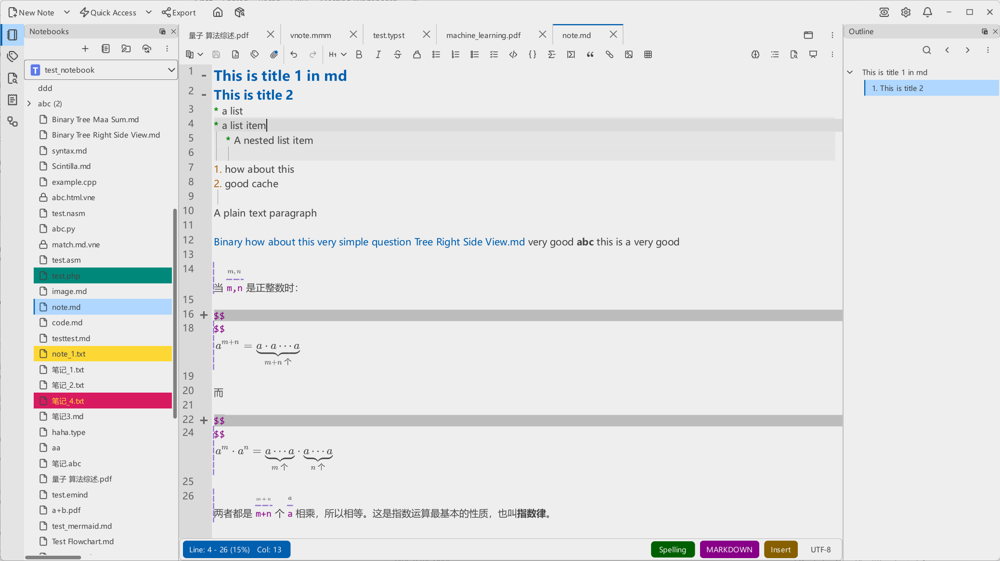
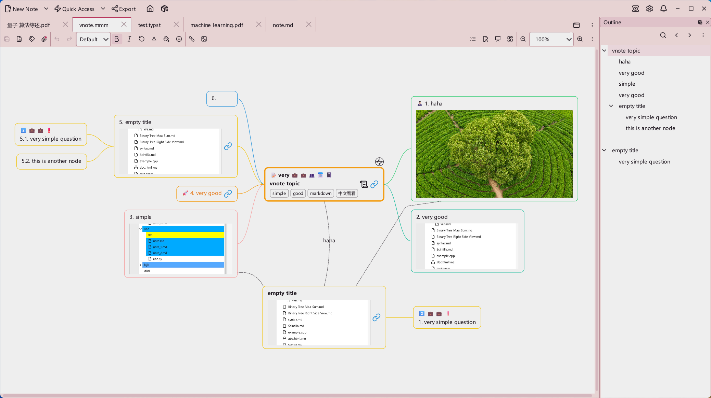
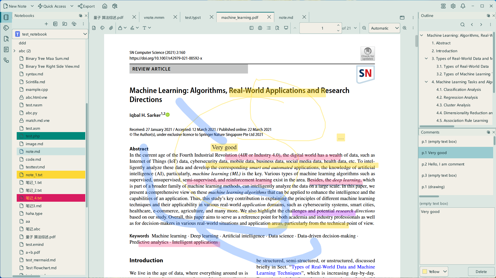

# VNote
  

[English](README.md)

[Gitee托管项目](https://gitee.com/vnotex/vnote)

一个舒适的笔记平台！

更多信息，请访问[VNote主页](https://docs.vnote.fun/zh)。

## 简介
**VNote**是一个基于Qt的开源免费笔记应用，将笔记管理与出色的编辑体验相结合，支持多种文档格式。

VNote支持**Linux**、**Windows**和**macOS**平台，需要**Qt 6.9及以上版本**。不再支持Qt 5.15和Windows 7。

### 支持的格式
**VNote不只是Markdown编辑器——以下格式现已支持：**

* **Markdown**（`.md`、`.mkd`、`.rmd`、`.markdown`）：编写、编辑和预览Markdown笔记
* **Typst**（`.typst`）：使用原生Typst编辑器编写和编辑排版文档，并实时预览PDF
* **纯文本和源代码**（`.txt`、`.log`、`.py`、`.cpp`、`.js`、`.json`、`.yaml`等）：编辑文本笔记、日志、代码和配置文件
* **思维导图**（`.mmm`、`.emind`）：使用原生思维导图编辑器创建和编辑导图
* **PDF**（`.pdf`）：使用内置阅读器阅读PDF文档

## 下载
基于`master`分支的[持续构建版本发布](https://github.com/vnotex/vnote/releases/tag/continuous-build)。

最新的[稳定版本发布](https://github.com/vnotex/vnote/releases/latest)，或者[Gitee发布](https://gitee.com/vnotex/vnote/releases)。

## 支持
* [GitHub Issues](https://github.com/vnotex/vnote/issues)；
* 邮件：`tamlokx at gmail.com`；
* 微信公众号：`vnotex`；

感谢这些[捐赠用户](https://github.com/vnotex/vnote/wiki/Donate-List)！

## 开发

前置依赖、环境配置和构建步骤，请参阅[开发指南](docs/development_zh_CN.md)。

## 许可
VNote遵循[GNU LGPLv3](https://opensource.org/licenses/LGPL-3.0)许可。

本项目附带的第三方素材及其许可要求的声明——Lucide（ISC/MIT）与 IconPark（Apache-2.0）
图标集——记录于 [THIRD-PARTY-NOTICES.md](THIRD-PARTY-NOTICES.md)。
