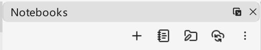

# Welcome to VNote
A pleasant note-taking platform, supporting Markdown, Mind Map, Typst, plain text, and PDF.

For more information, please visit [**VNote's Home Page**](https://docs.vnote.fun).

## Notebooks Management

There are two kinds of notebooks:

* **Bundled Notebook**: a dedicated folder managed by VNote, with rich features supported, like tags and attachments
* **Raw Notebook**: browsing a folder with previously existing files, with limited features supported, but being free from VNote's metadata files

Use "Open Notebook" to open previously created notebooks.