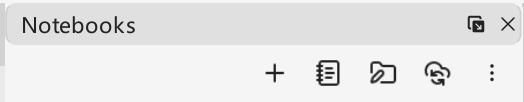

# 欢迎使用 VNote
一个舒适的笔记平台，支持 Markdown、思维导图、Typst、纯文本和 PDF。

更多信息，请访问 [**VNote 主页**](https://docs.vnote.fun)。

## 笔记本管理

笔记本分为两种类型：

* **自包笔记本（Bundled Notebook）**：由 VNote 管理的专用文件夹，支持标签、附件等丰富功能
* **原生笔记本（Raw Notebook）**：浏览已有文件的文件夹，支持的功能有限，但不会生成 VNote 的元数据文件

使用“打开笔记本”打开此前创建的笔记本。
